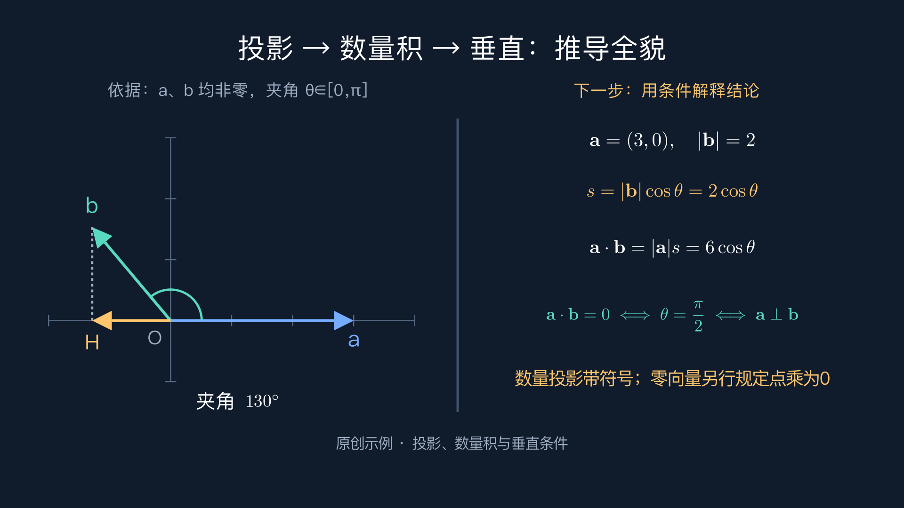

# Math Explainer Video · 数学动画讲解工作流

从知识笔记出发，生成可播放的数学讲解视频、中文配音、字幕与可收藏的推导全貌图。包含可安装的 Agent Skill，以及可脱离 Agent 单独运行的 Python 制作脚本。

**AI负责教学设计与编写动画，Manim负责按数学坐标绘图，edge-tts负责配音，FFmpeg负责合成。** 这里没有自动解题模型或LLM API客户端；CLI读取已经写好的讲稿和动画源码。要生成新的教学内容，需要支持Skill的Agent，或自行编写。



[教学设计流程](docs/WORKFLOW.md) · [运行文件约定](references/runtime.md) · [验证记录](docs/VALIDATION.md) · [贡献](CONTRIBUTING.md)

## 已有能力

- 讲解稿分段、同一声音配音、内容哈希缓存、有限重试；可完全关闭联网配音。
- Manim数学动画、按实际音频时长安排场景，支持局部重渲染和重新拼接。
- 横屏16:9默认，也支持9:16和1:1；尺寸、帧率可配置。
- 中文SRT/ASS；Pillow字幕合成不依赖FFmpeg的libass。
- 完整解码、音轨/尺寸/帧率检查和场景时长记录。
- 独立全貌PNG/PDF导出；原创投影示例保留上一步关系，逐步补充当前推导。

**数学与教学质量仍需审查。** 解码成功不是数学证明；字幕目前按分句字数估计，没有逐字强制对齐。技术验收不代表真实学生的学习效果已验证。

## 安装依赖

```sh
git clone https://github.com/cheng-bai/math-explainer-video.git
cd math-explainer-video
```

需要Python 3.11+、FFmpeg/ffprobe、Manim Community 0.20.x、LaTeX/dvisvgm和中文字体。建议使用虚拟环境；系统依赖与Python包分别安装。

macOS（Homebrew）：

```sh
brew install manim ffmpeg
brew install --cask mactex-no-gui
# 安装TeX后，重开终端；必要时将 /Library/TeX/texbin 加入PATH。
python3 -m venv .venv
source .venv/bin/activate
python -m pip install -r requirements.txt
```

Ubuntu/Debian：

```sh
sudo apt-get update
sudo apt-get install -y python3-venv python3-dev pkg-config libcairo2-dev libpango1.0-dev ffmpeg texlive-latex-base texlive-latex-extra texlive-fonts-recommended texlive-science dvisvgm fonts-noto-cjk
python3 -m venv .venv
. .venv/bin/activate
python -m pip install -r requirements.txt
```

Windows请先按[Manim官方文档](https://docs.manim.community/en/stable/installation.html)安装原生依赖，并安装中文字体。当前完整实测平台为macOS，其他平台支持程度见验证记录。

```sh
python scripts/doctor.py
```

中文字体优先自动选取系统中的PingFang SC、Noto Sans CJK SC或Microsoft YaHei。可分别设置 `MATH_VIDEO_FONT_FAMILY`（Manim字体名）和 `MATH_VIDEO_FONT_FILE`（字幕字体文件路径）；字体不随仓库分发。

## 先跑原创示例

```sh
# 已克隆项目并按上文安装依赖后：
mkdir -p work
cp -R examples/projection work/projection
python scripts/prepare_audio.py work/projection --silent --duration 12
python scripts/render_video.py work/projection
python scripts/export_overview.py work/projection
```

得到 `work/projection/video.mp4` 与 `overview.png` / `overview.pdf`。静音流程不访问语音服务，不要求API Key。首次安装依赖仍需要网络。

启用中文男声（会把讲解稿发送给edge-tts使用的在线语音服务）：

```sh
python scripts/prepare_audio.py work/projection --voice zh-CN-YunxiNeural --rate +0%
python scripts/render_video.py work/projection
```

也可以使用自己的录音或其他TTS生成的配音，按讲稿顺序保存 `00.mp3`、`01.mp3`…，自行确认内容、声音与授权一致：

```sh
python scripts/prepare_audio.py work/projection --audio-dir /path/to/your-audio
python scripts/render_video.py work/projection
```

声音改变或文字修改会使对应缓存失效。TTS最多重试3次，失败会中止；没有自动换声音或付费接口。edge-tts是第三方客户端，服务可用性和使用条件由相关服务决定，不保证长期免费或商用权利。本次验证中7.2.8曾返回握手错误，使用7.3.1后恢复；遇到同类错误先检查客户端版本，也可导入本地配音。

只重渲染修改过的一段：

```sh
python scripts/render_video.py work/projection --scenes Scene02
# 只重新拼接已经存在的分段：
python scripts/render_video.py work/projection --assemble-only
```

修改配音时长、分辨率或帧率后，应重渲所有受影响场景；旧场景配置不一致时会报错。

## 用作Skill

本仓库根目录就是 `math-explainer-video` Skill。Codex示例安装方式：

```sh
git clone https://github.com/cheng-bai/math-explainer-video.git "${CODEX_HOME:-$HOME/.codex}/skills/math-explainer-video"
```

目标已存在时先保留自己的版本，勿覆盖。重新加载Skills后可说：

> 用动画解释为什么数量积可以表示垂直关系。横屏，保留前一步依据，最后输出推导全貌图。

其他支持目录式Skills的Agent可按其安装方式使用，尚未逐个验证。Skill不会自动发布到视频平台。

## 创作新课程

```sh
python scripts/new_project.py my-lesson --root work
```

1. 按[知识笔记约定](references/knowledge-note-input.md)写教学笔记，保留来源与补充边界。
2. 编辑 `narration.json`，每项为一段自然语言口播。
3. 准备配音，读取 `timestamps.json` 中的实际时长。
4. 编辑 `script.py`：一项口播对应 `Scene01`、`Scene02`…；共享数学模型，不用独立插值伪造几何关系。
5. 渲染、检查关键动作及配音，必要时局部修复；导出独立全貌图。

初始化模板只是可执行起点，不是完整知识解释。原创示例有[知识笔记](examples/projection/knowledge-note.md)、分段讲稿和3段动画，可用于理解文件间的对应关系。

## 来源与许可

代码和本项目原创示例采用[MIT](LICENSE)。不包含上海教材/教参原文、私人题库、学生资料、用户机器路径、账号或密钥，也不附带商业字体。输入教材由使用者自行提供并确认使用范围。

本项目从本地多轮数学讲解制作流程提炼而来；没有复制huashu-art-motion或其他动画项目的代码。使用的第三方工具及其许可边界见[第三方说明](THIRD_PARTY_NOTICES.md)。MIT许可不替第三方字体、外部题目或在线语音服务授予权利。
